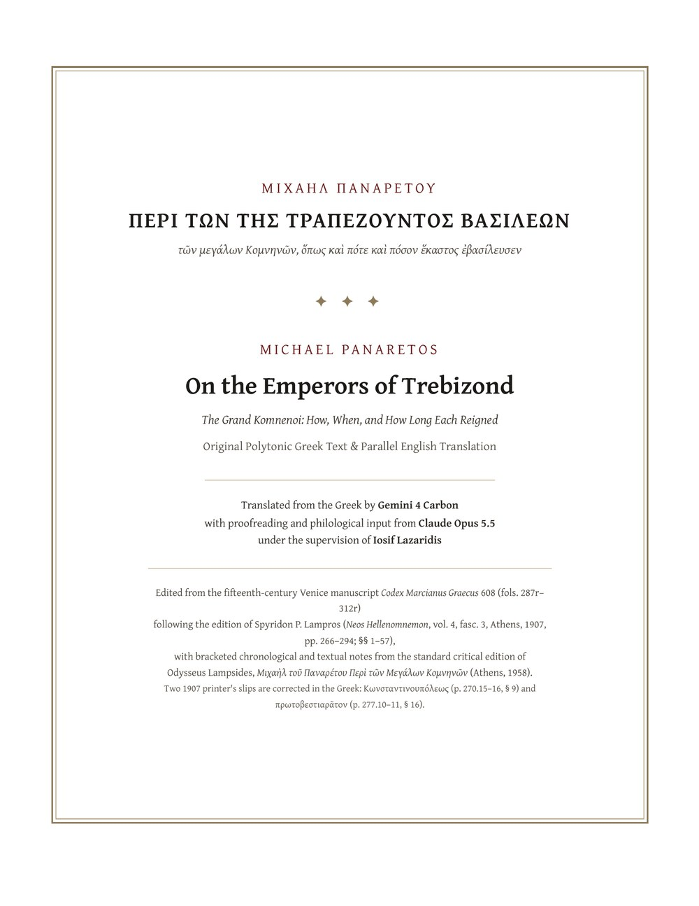

# Michael Panaretos, On the Emperors of Trebizond

Μιχαὴλ Παναρέτου, Περὶ τῶν τῆς Τραπεζοῦντος βασιλέων: the chronicle of the Grand Komnenoi of Trebizond, 1204–1426, in the Greek text and an English translation, side by side (PDF, 22 pages).

**Open the page:** https://iosiflazaridis.github.io/panaretos-chronicle/  
**Download the PDF:** [Panaretos_Chronicle_of_Trebizond.pdf](Panaretos_Chronicle_of_Trebizond.pdf)

- **Greek text:** Sp. P. Lampros, *Τὸ Τραπεζουντιακὸν Χρονικὸν τοῦ πρωτοσεβαστοῦ καὶ πρωτονοταρίου Μιχαὴλ Παναρέτου*, Νέος Ἑλληνομνήμων 4 (Athens 1907), pp. 266–294, from Codex Marcianus Graecus 608, fols. 287r–312r. Where the critical edition of O. Lampsides (Athens 1958), the manuscript or the calendar corrects Lampros, the English gives the correct reading in brackets.
- **Translation:** from the Greek by Gemini 4 Carbon, with proofreading and philological input from Claude Opus 5.5, under the supervision of Iosif Lazaridis ([@iosif_lazaridis](https://x.com/iosif_lazaridis)).
- **Layout:** 57 sections, Greek and English in parallel columns, with Lampros's page numbers.

See also: [Bessarion, Encomium on Trebizond](https://iosiflazaridis.github.io/bessarion-encomium/).

The page uses the EB Garamond typeface, included under the SIL Open Font License (`fonts/OFL.txt`).
